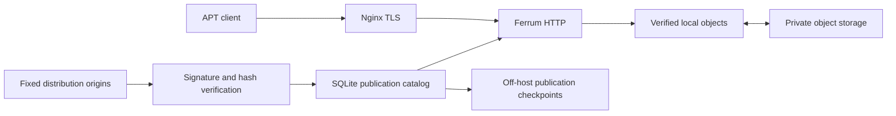

<div align="center">

<h1>Ferrum</h1>
<p>A Rust APT, Pacman and RPM gateway with signed metadata, verified package delivery and bounded storage.</p>
</div>

---

Ferrum serves ordinary APT clients through an on-demand local cache and private S3-compatible storage. Clients keep their distribution's signing keys and package manager; only repository URLs change. Unlike a full mirror, Ferrum downloads package bodies when requested rather than copying an entire archive.

APT's signed metadata authorizes package paths. Cold downloads are completely checked against the authenticated size and SHA-256 before Ferrum sends package bytes. SQLite tracks publication, retention and transfer allowances; off-host checkpoints record the minimum recoverable generation. This trades cold-request latency for verify-before-serve integrity.

- **Normal APT authentication:** no Ferrum signing key or client agent.
- **Shared downloads:** concurrent requests share one bounded fill.
- **HTTP semantics:** GET, HEAD, conditional requests and verified single-byte ranges.
- **Bounded resources:** disk reservations, transfer budgets and concurrency limits.
- **Per-suite publication:** a failed update does not replace the current authenticated view.

## Contents

- [Use the public mirror](#use-the-public-mirror)
- [Build from source](#build-from-source)
- [Run the local proof](#run-the-local-proof)
- [Host your own gateway](#host-your-own-gateway)
- [Admin dashboard](#admin-dashboard)
- [Architecture and limits](#architecture-and-limits)
- [Development](#development)
- [Contributing and license](#contributing-and-license)

## Use the public mirror

Public endpoint: **https://ferrum.oneshot.wtf**. The implemented acquisition profile is **amd64 binaries plus architecture-independent packages**, not every APT distribution or architecture. Debian 13 (`trixie`) and Ubuntu 24.04 (`noble`) have recorded client acceptance evidence. Additional configured suites are not equivalent to complete client qualification; see the [test record](docs/b01-test-contract.md).

The routes below describe implemented profiles; a deployment may enable only a subset. They are not a live availability or all-distribution qualification guarantee.

Back up your sources before editing:

```sh
sudo cp -a /etc/apt "/etc/apt.backup-$(date +%Y%m%d-%H%M%S)"
```

In your existing `.sources` or `.list` files, replace **only the binary repository URI**, using the mapping below. Keep your installed release codename, components, `Architectures` and `Signed-By`. Do not add duplicate entries, change release versions or replace third-party repositories.

| Repository | Ferrum URI | Example suites |
| --- | --- | --- |
| Debian archive | `https://ferrum.oneshot.wtf/debian` | `trixie trixie-updates` |
| Debian security | `https://ferrum.oneshot.wtf/debian-security` | `trixie-security` |
| Ubuntu archive | `https://ferrum.oneshot.wtf/ubuntu` | `noble noble-updates` |
| Ubuntu security | `https://ferrum.oneshot.wtf/ubuntu-security` | `noble-security` |
| Ubuntu Ports (`arm64`) | `https://ferrum.oneshot.wtf/ubuntu-ports` | `noble noble-updates noble-security` |
| Docker CE | `https://ferrum.oneshot.wtf/docker-debian` / `.../docker-ubuntu` | `trixie bookworm noble jammy` (`stable`) |
| Tailscale | `https://ferrum.oneshot.wtf/tailscale-debian` / `.../tailscale-ubuntu` | `trixie bookworm noble jammy` (`main`) |
| PostgreSQL PGDG | `https://ferrum.oneshot.wtf/postgresql-apt` | `trixie-pgdg bookworm-pgdg noble-pgdg jammy-pgdg` |
| Grafana | `https://ferrum.oneshot.wtf/grafana-apt` | `stable` (`main`) |
| Arch Linux (`pacman`) | `https://ferrum.oneshot.wtf/archlinux/$repo/os/$arch` | `core extra multilib` (`x86_64`) |
| Chaotic-AUR (`pacman`) | `https://ferrum.oneshot.wtf/chaotic-aur/$repo/$arch` | `chaotic-aur` (`x86_64`) |
| CachyOS (`pacman`) | `https://ferrum.oneshot.wtf/cachyos/x86_64/$repo` | `cachyos` |
| CachyOS v3 (`pacman`) | `https://ferrum.oneshot.wtf/cachyos/x86_64_v3/$repo` | `cachyos-v3` (requires x86-64-v3 CPU support) |
| CachyOS v4 (`pacman`) | `https://ferrum.oneshot.wtf/cachyos/x86_64_v4/$repo` | `cachyos-v4` (requires x86-64-v4 CPU support) |
| ArchLinuxCN (`pacman`) | `https://ferrum.oneshot.wtf/archlinuxcn/$repo/$arch` | `archlinuxcn` (`x86_64`) |
| EndeavourOS (`pacman`) | `https://ferrum.oneshot.wtf/endeavouros/$repo/$arch` | `endeavouros` (`x86_64`) |
| AlmaLinux (`dnf`) | `https://ferrum.oneshot.wtf/almalinux/$releasever/BaseOS/$basearch/os/` | `9 10` (`BaseOS`, `AppStream`, `extras`; `x86_64`, `aarch64`) |
| Rocky Linux (`dnf`) | `https://ferrum.oneshot.wtf/rockylinux/$releasever/BaseOS/$basearch/os/` | `9 10` (`BaseOS`, `AppStream`, `extras`; `x86_64`, `aarch64`) |

For example, Ubuntu 24.04's `/etc/apt/sources.list.d/ubuntu.sources` can contain:

```text
Types: deb
URIs: https://ferrum.oneshot.wtf/ubuntu
Suites: noble noble-updates
Components: main restricted universe multiverse
Architectures: amd64
Signed-By: /usr/share/keyrings/ubuntu-archive-keyring.gpg

Types: deb
URIs: https://ferrum.oneshot.wtf/ubuntu-security
Suites: noble-security
Components: main restricted universe multiverse
Architectures: amd64
Signed-By: /usr/share/keyrings/ubuntu-archive-keyring.gpg
```

Ubuntu 22.04 uses `jammy`, `jammy-updates` and `jammy-security`; its routes are configured on the public service, but the recorded automated client baseline above is narrower. Debian uses `main contrib non-free non-free-firmware` and `/usr/share/keyrings/debian-archive-keyring.gpg`.

Keep `deb-src`, foreign architectures and unsupported repositories on their original servers. If an entry combines `Types: deb deb-src`, split it before changing the binary URI. Keeping security updates on the official distribution service is also supported and avoids dependence on this gateway's availability.

```sh
sudo apt-get update
apt-cache policy
sudo apt-get --download-only --reinstall install hello
```

Check that the update output and policy list the intended Ferrum URLs. These commands do not upgrade installed packages. Stop on signature, expiry or hash errors; never use `trusted=yes`, disable authentication or bypass expiry. To revert, restore the source files from your backup and run `apt-get update` again.

## Build from source

Build on Linux, outside the serving VM. The repository pins Rust **1.99.1**; install [rustup](https://rustup.rs/) first. On a Debian 13 build host:

```sh
sudo apt-get update
sudo apt-get install -y build-essential pkg-config clang libclang-dev \
  nettle-dev libgmp-dev libbz2-dev liblzma-dev ca-certificates git

git clone https://github.com/0neShot101/ferrum.git
cd ferrum
cargo build --release --locked -p ferrum -p ferrum-verifier
./target/release/ferrum --help
./target/release/ferrum-verifier --version
```

Deploy both binaries together. The verifier uses native Nettle/GMP libraries; build for the serving machine's architecture and compatible Linux runtime. Do not enable the `test-harness` feature in production builds.

## Run the local proof

With Bash and Docker running Linux containers:

```sh
bash fixture/smoke.sh
```

The harness builds a tiny signed repository, runs Ferrum on container-local loopback, and exercises a stock Debian 13 update, download and install. The installed command prints `ferrum-fixture-ok`. It also checks corruption and HTTP behavior. No S3 credentials or public ports are needed. Generated keys and logs stay under ignored `fixture/private`, `fixture/public` and `fixture/run`; see [fixture/README.md](fixture/README.md).

## Host your own gateway

Requires a dedicated Linux host with synchronized time, both release binaries, Nginx **1.25.1+**, a domain/TLS certificate, distribution archive keyrings and a private S3-compatible bucket. The default disk limits target a 250 GB-class volume and 8 GiB RAM; this is not a capacity guarantee for every configured suite.

<details>
<summary>Installation and first startup</summary>

From a checkout containing the release binaries, on the serving host:

```sh
sudo useradd --system --home-dir /var/lib/ferrum --shell /usr/sbin/nologin ferrum
sudo install -d -m 0755 /etc/ferrum /etc/ferrum/keyrings
sudo install -d -o ferrum -g ferrum -m 0700 /var/lib/ferrum /var/lib/ferrum/private
sudo install -m 0755 target/release/ferrum target/release/ferrum-verifier /usr/local/bin/
sudo install -m 0644 deploy/gateway.toml deploy/maintenance.toml /etc/ferrum/
sudo install -m 0644 deploy/systemd/ferrum.service /etc/systemd/system/
sudoedit /etc/ferrum/gateway.toml /etc/ferrum/maintenance.toml
```

Before proceeding:

1. Set your hostname in `listen.public_host`. Keep both listeners on loopback.
2. Set your private S3 bucket in `durable.provider` (and matching `provider` in `maintenance.toml`). For AWS S3, set `region` (`endpoint` defaults to `https://s3.<region>.amazonaws.com`). For Cloudflare R2, set `provider = 'cloudflare-r2'` and `account_id = '<account_id>'` (or `endpoint = 'https://<account_id>.r2.cloudflarestorage.com'`, with `region` defaulting to `'auto'`). For IDrive e2, set `provider = 'idrive-e2'` and `region = 'us-central-1'` (or `endpoint = 'https://s3.us-central-1.idrivee2.com'`). Any other HTTPS S3-compatible endpoint URL is also supported. `package_prefix` (`linux-packages/`), `checkpoint_prefix` (`linux-checkpoints/`), and `shared_nonisolated` (`true`) are optional and may be customized if non-overlapping.
3. Review the example 1 TiB storage/monthly-download caps and 100 GiB control headroom. The counters are admission limits, not a billing guarantee. Disable lifecycle expiration for Ferrum objects and review versioning costs.
4. Install the Debian archive keyring from the distribution package. For Ubuntu, copy the archive keyring from a trusted Ubuntu installation to the configured root-owned path. Obtain any other keyrings independently through the corresponding distribution's trusted installation process, not from a package request.
5. Omitted suite lists select Debian trixie and Ubuntu noble, including their update/security pockets. If selecting a subset, set matching `durable.suites` and maintenance `suites` arrays of `repository/suite` names. Do not enable `all` merely because entries exist in the allowlist. To retire a published suite, stop Ferrum, move it from `durable.suites` to `durable.retired_suites` (and make the matching maintenance change), retain its current keyring, then restart. Removing it from both lists is rejected.

Create `/var/lib/ferrum/private/provider.env` with your bucket credentials (optional `AWS_ENDPOINT_URL_S3`, `AWS_REGION`, `FERRUM_S3_BUCKET`, and `FERRUM_S3_PREFIX` are also verified against the TOML configuration if present):

| Variable | Value |
| --- | --- |
| `AWS_ACCESS_KEY_ID` | Your bucket credential's access key |
| `AWS_SECRET_ACCESS_KEY` | Its secret key |
Use `NAME=value` lines, not shell commands. Session tokens and proxy environment variables are not supported. Protect the file before startup:

```sh
sudo chown ferrum:ferrum /var/lib/ferrum/private/provider.env
sudo chmod 0600 /var/lib/ferrum/private/provider.env
```

For a **new, empty deployment only**, initialize accounting and record the initial bootstrap. Never use this to repair lost state, reset an allowance or adopt an existing bucket's Ferrum data:

```sh
sudo -u ferrum /usr/local/bin/ferrum storage \
  --config /etc/ferrum/maintenance.toml init \
  --operator "$USER" --reason 'First startup of an empty deployment' \
  --disclosure 'HISTORICAL ROLLBACK PROTECTION RESET; NOT RECOVERED'
sudo systemctl daemon-reload
sudo systemctl enable --now ferrum
sudo journalctl -u ferrum -n 50 --no-pager
curl --fail http://127.0.0.1:9090/readyz
```

Initial metadata synchronization can take time. A successful process start is not readiness. Investigate individual suite errors instead of bypassing verification or resetting the catalog.

To trigger an immediate synchronization on a running gateway (or run a one-shot offline sync with `--offline`) for all mirrors, one mirror repository, or a specific suite:

```sh
ferrum sync --config /etc/ferrum/gateway.toml
ferrum sync --config /etc/ferrum/gateway.toml debian
ferrum sync --config /etc/ferrum/gateway.toml archlinux/core
ferrum sync --config /etc/ferrum/gateway.toml --offline debian/trixie
```

Prewarm explicitly selected package paths through the running private listener:

```sh
ferrum prewarm --config /etc/ferrum/gateway.toml run \
  --max-bytes 1073741824 "$AUTHENTICATED_PACKAGE_PATH"
ferrum prewarm --config /etc/ferrum/gateway.toml status "$JOB_ID"
ferrum prewarm --config /etc/ferrum/gateway.toml cancel "$JOB_ID"
```

Use package paths from the active authenticated catalog, not arbitrary URLs. One prewarm job runs at a time; its hard bounds are 128 package/signature objects, 8 GiB of admitted bytes, four workers and one hour. Defaults are one worker and five minutes. It reserves foreground fill capacity, uses normal verification/capture, and rejects the complete batch before transfer if its declared budget cannot cover it. The byte cap counts authenticated package sizes plus conservative detached-signature allowance, **not wire traffic or billing**; retries and capture verification remain subject to the existing transfer ledger. Cancellation stops unshared background work, but a foreground-shared fill may finish. Activity and task details expose progress and cancellation.

Retired suites have no public routes or new synchronization work. Retirement preserves rollback floors, historical capture authority and accounting; it is not deletion or garbage collection. Current keyrings remain required for retained proofs. Reactivation moves the identity back to the active list and requires normal verified recovery/synchronization before serving.

For the HTTPS edge, merge `deploy/nginx/ferrum-http.conf` into Nginx's `http` settings, replacing duplicate directives such as `keepalive_timeout` rather than including them twice. Install `ferrum-site.conf` as the virtual host and `ferrum-proxy.conf` as `/etc/nginx/snippets/ferrum-boundary.conf`. Replace every example hostname and both certificate paths with your own. Integrate the default reject listeners with existing virtual hosts; do not duplicate `default_server` declarations. Validate with `sudo nginx -t` before reloading. Never expose port 9090.

Test normal APT update/download/install from a disposable client using your domain before changing real clients. `/healthz` checks only the edge, not repository readiness. Repeat after a process restart. Provider compatibility, retention, recovery and capacity need independent qualification for your deployment; successful startup is not that qualification.

**This revision requires `ferrum-verifier 0.2.0`.** Stop Ferrum, back up its existing state offline, and upgrade the gateway and verifier together. Catalog schema v5 adds package-signature recovery bindings without resetting allowances, ownership or history. Never run `storage init` over existing state or reopen an upgraded catalog with an older binary.

**Upgrading a pre-binding checkout:** stop Ferrum first, replace `durable.credentials_file` with the explicit `[durable.provider]` table and install the new binaries. Preserve the existing provider, state and allowance values; never rerun `init` on that state. New catalogs are bound to their provider, and a mismatched provider is rejected.

Legacy adoption is an offline, audited operation for a pre-binding catalog whose objects match the configured provider and prefixes. Independently verify that ownership before running:

```sh
sudo -u ferrum /usr/local/bin/ferrum storage \
  --config /etc/ferrum/maintenance.toml adopt-legacy-provider \
  --operator "$USER" --reason 'Verified original provider before upgrade' \
  --disclosure 'LEGACY PROVIDER VERIFIED; NO DATA OR ALLOWANCE RESET'
```

This records ownership without provider requests or resetting balances/history. It cannot change an existing binding or migrate to another bucket. Restart only after configuration and ownership checks pass.

</details>

## Admin dashboard

The dashboard is served on the **private admin listener**, normally `127.0.0.1:9090`. It provides eight operational views (**Overview**, **Mirrors**, **Packages**, **Storage**, **Activity**, **Settings**, **Account**, and **Users**): live 5-second telemetry and 7-day minute rollups, all compiled APT/Pacman/RPM repository profiles (distinguishing configured suites from unconfigured candidates), actor-integrated synchronization jobs, a zero-S3-call catalog explorer of captured packages, local spool and S3 allowance diagnostics, safe local cache reclamation, validated configuration proposals, and saved per-user fixed-widget workspaces.

Build the static UI with [Bun](https://bun.sh/):

```sh
(cd ui && bun install --frozen-lockfile && bun run check && bun run build)
```

Ferrum finds `ui/build` when launched from the checkout. For an installed service, copy that directory to a service-readable location and set `FERRUM_UI_DIR` to its absolute path in the service environment. No separate Node server is needed. Administration state defaults to a sibling `<state_dir>.admin` directory, separate from the spool and catalog. Retrieve the one-time setup token with `sudo -u ferrum ferrum admin setup-token --config /etc/ferrum/gateway.toml` to create the initial administrator; if a pre-upgrade `admin-users.json` exists in the stopped spool, migrate it first with `sudo -u ferrum ferrum admin migrate --config /etc/ferrum/gateway.toml`.

**Keep the admin listener private.** Never publish port 9090 through the public mirror virtual host. For remote access, forward the exact configured origin port over SSH:

```sh
ssh -N -L 9090:127.0.0.1:9090 user@your-server
```

Open `http://127.0.0.1:9090` (or set `[admin].origin` if using a different local tunnel port). Detailed `/metrics` and live `ferrum sync` triggers use the protected local control token (`ferrum admin control-token --config /etc/ferrum/gateway.toml`), while `/healthz`, `/livez` and `/readyz` remain loopback probes. Package browsing reads the local SQLite catalog with zero provider requests and never mutates transfer allowances. Configuration proposals remain read-only unless a host operator explicitly adopts a dedicated writable config (`ferrum admin adopt-config --config /etc/ferrum/gateway.toml --output /var/lib/ferrum/config/gateway.toml`), and saved changes require a manual gateway restart.

## Architecture and limits



This is an on-demand gateway, not an official full mirror or historical snapshot service. Never-fetched packages deleted upstream cannot be recovered. By-hash protects index selection where the archive supports it; canonical-only repositories can require retries across publication changes. Independent pockets and detached signature requests are not atomic client sessions.

Cold fills may outlast APT's retry window: Ferrum returns bounded 503 responses while the shared producer continues, so a later invocation may be needed. APT/RPM warm objects are not rehashed on every read; clients still verify their downloads.

For supported APT archives, Ferrum serves optional authenticated PDiffs: signed Release hashes authenticate the plain `.diff/Index`, which authenticates the complete gzip patch closure. Unsupported, incomplete or invalid optional closures fall back to full indexes. Limits are 32 PDiff roots per suite, a 1 MiB Index, 64 patches per root, 16 MiB per compressed patch, 64 MiB of combined compressed/expanded closure bytes, and 256 MiB of optional suite staging. Patches are canonical generation-bound paths, not new by-hash aliases. This can reduce client update traffic; Ferrum still acquires full indexes for its own authenticated catalog.

**Pacman has a different trust boundary:** repository databases are unsigned transport candidates, not authenticated indexes. Every served package must pass its own signature check under the configured current keyring; a valid canary does not authorize other packages. Local checkpoint sequences and origin-confirmation leases do not provide cryptographic repository-version rollback protection.

Pacman verification currently rereads the entire package for each GET, including Range and signature requests, and for positive resident HEAD/304 responses. Recovery also verifies retained package/signature pairs. Those costs invalidate earlier warm-throughput claims for Pacman. Re-signing a dynamically discovered detached signature without changing the database can remain unavailable after a keyring change; automatic signature revision is not qualified. It fails closed rather than accepting the obsolete signer.

The supported shared-credential storage profile is **NONISOLATED**. Its checkpoints protect ordinary local-state-loss recovery only while the remote floor and artifacts remain trusted. They do not protect against shared-key compromise or bucket loss. Keep backups and keys secure; do not reset the persisted allowance ledger after a restart.

Additional repository profiles include Arch Linux, Chaotic-AUR, CachyOS, ArchLinuxCN, EndeavourOS, AlmaLinux, Rocky Linux, Ubuntu Ports (`arm64`), Docker CE, Tailscale, PostgreSQL PGDG, Grafana, Kali, Parrot, Trisquel, Raspberry Pi's vendor archive and Proxmox no-subscription repositories. Curate enabled suites so the hot working set fits your local NVMe spool; cold-miss spikes return `503 Retry-After: 5` backpressure rather than `429` hard errors. **No Proxmox enterprise credentials, unbuilt `aur.archlinux.org` PKGBUILD source proxying, or source packages.** Long-duration capacity, recovery and performance gates remain distinct from functional tests; the [test record](docs/b01-test-contract.md) distinguishes measured results from open gates.

## Development

| Command | Purpose |
| --- | --- |
| `cargo build --workspace --locked` | Build the gateway, verifier and fixture origin |
| `PATH="$PWD/target/debug:$PATH" cargo test --workspace --locked --features ferrum/test-harness` | Run unit and integration tests using the built verifier |
| `cargo clippy --workspace --all-targets --locked --features ferrum/test-harness -- -D warnings` | Check correctness/style/performance warnings |
| `cargo fmt --all -- --check` | Check standard Rust formatting |
| `cargo run --release --locked -p ferrum --features test-harness --example throughput -- serve` | Start a disposable loopback gateway for verified before/after HTTP measurements |

Signed publication tests require generated fixture data; [fixture/README.md](fixture/README.md) documents setup. `tools/distribution-inventory` and `tools/e2-probe` are separate Cargo workspaces. Provider probes require explicit disposable namespaces and allowances; never point a cleanup probe at live data.

Core ownership: `ferrum-apt` handles authenticated metadata, `ferrum-storage` owns persistence/accounting, `ferrum` handles orchestration/HTTP, and `ferrum-verifier` isolates signature checks. Implementation and reviews used AI assistance; executable evidence, not generated code or reviewer assertions, determines acceptance.

UI conventions: neutral dark/light surfaces, the supplied Ferrum logo, and orange reserved for primary actions. Segoe UI/system sans-serif uses a 12/13/16/24 px scale; numbers use tabular figures and only identifiers use monospace. Tables follow [Carbon's data-table guidance](https://carbondesignsystem.com/components/data-table/usage/), with contained horizontal scrolling and responsive sidebar/drawer navigation. Keep metrics factual; do not add synthetic graphs or decorative status badges.

## Contributing and license

Report reproducible problems or open focused pull requests on [GitHub](https://github.com/0neShot101/ferrum). Include the affected release, expected behavior and sanitized logs; never attach credentials or signing keys.

[MIT](LICENSE), copyright Andrew. This license covers Ferrum, not mirrored distribution packages. Operators must separately satisfy those packages' redistribution and corresponding-source obligations.
